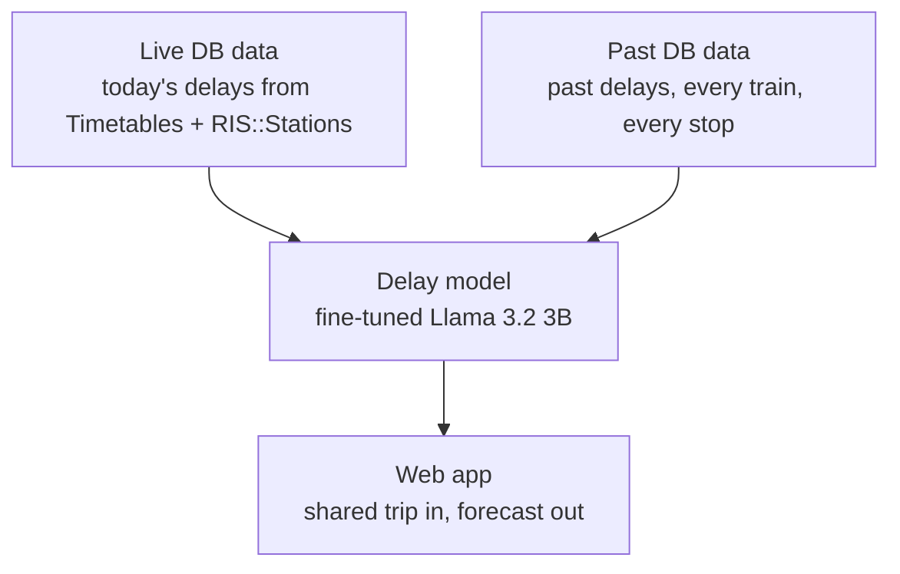

# delayedBahn — error404.ai

Share your train trip, and delayedBahn tells you how late each train is likely to be and whether you will make your change. It learns from Deutsche Bahn's own timetable and delay data.

Built by team error404.ai at the European Hackathon League Zurich.


## Contents
1. [Problem](#problem)
2. [What we built](#what-we-built)
3. [The app](#the-app)
4. [Data sources](#data-sources)
5. [What the DB data solves](#what-the-db-data-solves)
6. [Architecture](#architecture)
7. [Model](#model)
8. [Code structure](#code-structure)
9. [Quickstart](#quickstart)
10. [Team](#team)
11. [Built with](#built-with)
12. [Screenshots](#screenshots)

---

## Problem
- The DB app shows the planned journey, not the chance that it actually works.
- A trip with a change fails at its tightest connection, and travellers only find out on the platform.
- Delays are uneven: most trains are a few minutes late, a few are very late. A single "expected delay" hides the risk.

## What we built
- **Share a trip** from the DB app into our web app. It reads the trains, stations and times.
- **Get a forecast per train**: likely arrival delay, a range, and the chance of making each change.
- **Get advice**: the plan is fine, add buffer, or take an earlier or later connection.

## The app
- **Start screen:** paste the text you copied from the DB app, or share it straight from your phone. The app can be installed on your home screen.
- **Map:** your route drawn on a map of Germany, with the trains moving along it.
- **Train cards:** one card per train with the likely delay, the range, and a short explanation from the model.
- **Advice:** a clear verdict for the whole trip, and other options if a change looks tight.

---

## Data sources
All product data comes from Deutsche Bahn's official API Marketplace.

| API | What we use it for | Endpoints | Coverage | Auth |
|---|---|---|---|---|
| [Timetables](https://developers.deutschebahn.com/db-api-marketplace/apis/product/timetables) | Planned stops, live delays, cancellations, platform changes, route of every train | `station/{name}`, `plan/{eva}/{date}/{hour}`, `fchg/{eva}` | Current and upcoming trains | `DB_CLIENT_ID`, `DB_API_KEY` (free plan) |
| [RIS::Stations](https://developers.deutschebahn.com/db-api-marketplace/apis/product/ris-stations) | Official station names and EVA numbers | `stop-places/by-key` | Current | Same keys |

Both APIs are called with the headers `DB-Client-Id` and `DB-Api-Key` (`scripts/db_timetables.py`, `scripts/db_live_extract.py`). The history used for training are stored responses from the same Timetables feeds, in one row per train per stop, published as [`piebro/deutsche-bahn-data`](https://huggingface.co/datasets/piebro/deutsche-bahn-data).

## What the DB data solves
| Traveller problem | DB data that answers it |
|---|---|
| "Which train and station is this?" | Timetables `station` lookup and RIS::Stations turn names from the share text into exact EVA station IDs |
| "Is my train late right now?" | The Timetables change feed (`fchg`) gives the current delay at every stop the train has passed |
| "Will it get worse before my stop?" | Planned route (`ppth`) and stops ahead, plus how earlier trains on the same line did today |
| "Is this station having a bad day?" | Late share across all trains at the station recently |
| "Will this train be cancelled?" | Cancellation flags in the change feed, and how often this route was cancelled before |
| "Will I make my change?" | Planned arrival and departure times of both trains, combined with both delay forecasts |

---

## Architecture


1. **Collect:** we read timetables and delays from the DB APIs.
2. **Learn:** the model learns how delays grow along a trip from past records.
3. **Predict:** when you share a trip, the app sends it to the model together with today's live delays and shows you the forecast.

## Model
- **Base model:** Llama 3.2 3B (`unsloth/Llama-3.2-3B`), extended with [OpenTSLM](https://arxiv.org/abs/2510.02410) so it can read time series next to text. Starts from the `OpenTSLM/llama-3.2-3b-m4-sp` checkpoint and is fine-tuned with LoRA.
- **Training data:** past DB stop records, turned into training examples. Each example is one train and one stop it is heading to.
- **Input:** for one train and one target stop, the delays so far on this trip, how earlier trains to that stop did, and the recent lateness of the station, as numbers and one short sentence.
- **Output:** `Answer: <minutes>` or `Answer: cancelled`. From this we read the most likely delay, a range, and the chance of cancellation.
- **Connections:** the chance of making a change comes from the two trains' forecasts and the planned transfer time (`trip/connection.py`).
- **Training:** fine-tuned on Nebius GPUs. Full commands are in `app/agents/src/features/db_delay/trip/README.md`.

---

## Code structure
```
api/                   Vercel entry: sends /api/* to the backend
app/backend/           Node API (no dependencies): parse share text, predict, recommend
app/frontend/          React web app: paste or share a trip, forecast, advice, map
app/agents/            Python: data building, model training, model server
  src/features/db_delay/trip/   the delay model (build, train, serve)
  src/features/db_route/        route-level delay experiments
scripts/               DB Timetables and RIS::Stations clients
team-setup/            team coordination: tasks, decisions, hooks
bootstrap.sh           local setup check
```

| File | What it does |
|---|---|
| `scripts/db_live_extract.py` | Calls Timetables and RIS::Stations, merges plan and changes into one row per train per stop |
| `scripts/db_timetables.py` | Prints the next departures and delays for a station |
| `app/backend/src/features/share-parser/grammar.js` | Reads DB share text into a journey (`POST /api/journeys/parse`) |
| `app/backend/src/features/delay-prediction/routes/delay-prediction.js` | Asks the model for each train, works out change risk (`POST /api/predict`) |
| `app/backend/src/features/recommendation/routes/recommendation.js` | Gives the verdict and alternatives (`POST /api/recommend`) |
| `app/agents/src/features/db_delay/trip/build.py` | Turns stop records into training examples |
| `app/agents/src/features/db_delay/trip/train.py` | Fine-tunes the model |
| `app/agents/src/features/db_delay/trip/serve.py` | Serves forecasts to the backend, using live Timetables data |

---

## Quickstart
```bash
git clone https://github.com/KiraKami-dev/temporal_ai_error404.ai.git
cd temporal_ai_error404.ai
cp .env.example .env               # add DB_CLIENT_ID and DB_API_KEY from developers.deutschebahn.com
ln -s ../../.env app/backend/.env

python3 scripts/db_timetables.py "Hamburg Hbf"                      # live departures from DB

cd app/backend && npm run dev                                       # terminal 1: API on http://localhost:8000
npm --prefix app/frontend ci && npm --prefix app/frontend run dev   # terminal 2, repo root: app on http://127.0.0.1:5173
```
To run the trained model locally, see "Model files (required)" in `app/agents/src/features/db_delay/trip/README.md`.

## Team
error404.ai — Akshat Khair, Gaurav Kulkarni, Jonas (`josteng`), Yash (`yash-epte`)

## Built with
- European Hackathon League Zurich
- Deutsche Bahn API Marketplace: [Timetables](https://developers.deutschebahn.com/db-api-marketplace/apis/product/timetables), [RIS::Stations](https://developers.deutschebahn.com/db-api-marketplace/apis/product/ris-stations)
- [OpenTSLM](https://arxiv.org/abs/2510.02410), Llama 3.2, Nebius GPUs

---

## Screenshots


