# DelayedBahn

**Share your DB trip. Know which change will break, and what to do about it.**

DelayedBahn is an installable web app for Deutsche Bahn travellers. Share a journey from DB Navigator and it forecasts how late each train is likely to be, the chance of making every change, and the best move if a change is at risk. Two fine-tuned time-series language models, trained on DB's own delay history and fed today's live data, answer every trip.

Built by team **error404.ai** at the European Hackathon League Zurich, September 2026.

<p align="center">
  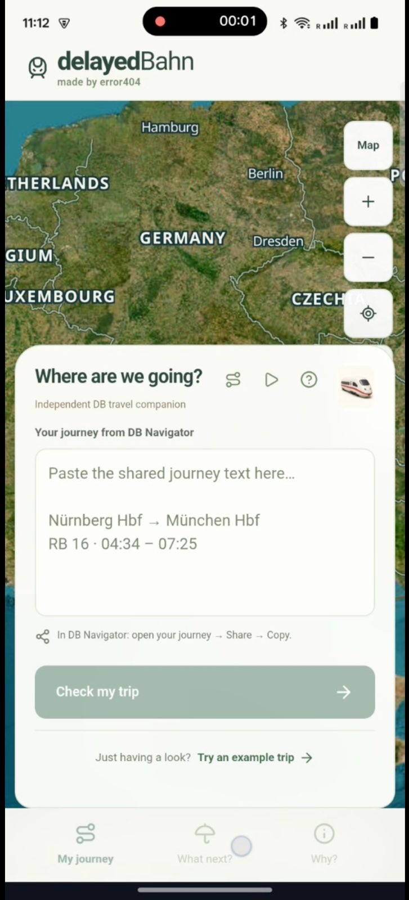
</p>

---

## Contents

1. [Problem](#problem)
2. [What we built](#what-we-built)
3. [Features](#features)
4. [How a shared trip flows through the system](#how-a-shared-trip-flows-through-the-system)
5. [Architecture](#architecture)
6. [Data](#data)
7. [Agentic data retrieval](#agentic-data-retrieval)
8. [Models](#models)
9. [Approach: two methods, combined](#approach-two-methods-combined)
10. [Evaluation](#evaluation)
11. [Code structure](#code-structure)
12. [Quickstart](#quickstart)
13. [Team](#team)
14. [Built with](#built-with)
15. [Screenshots](#screenshots)

---

## Problem

Everyone who travels with Deutsche Bahn knows the situation: trains are late and connections break. The DB app shows the planned journey, not the chance that it actually works. A trip with a change fails at its tightest connection, and travellers find out on the platform.

We cannot fix delays for everyone. We can give each traveller a more reliable and comfortable journey: know in advance which change is at risk, how much buffer would fix it, and which alternative to take if it fails. That is where the app comes in.

Three things make this hard, and shape the design:

- **Delays are uneven.** Most trains are a few minutes late, a few are very late. A single "expected delay" hides the risk. A traveller needs a range and the probability of the tight change.
- **A journey is a chain.** It fails at its weakest transfer, so per-train forecasts must be chained across changes.
- **The data is scattered.** Live positions from the DB API, history in open datasets, station cause codes, cancellation rates. Deciding what to fetch and what to drop is a task of its own.

## What we built

- **Share a trip** from DB Navigator straight into the app. It reads trains, stations and times from the share text.
- **A forecast per train:** likely arrival delay, a range, the chance of arriving on time, and the chance of making each change, chained over the whole journey.
- **Advice:** the plan is fine, add some buffer, leave home by this time, or take one of these alternatives. Already missed a change? The next connections from where you stand, each scored.
- **The model's own words:** for every train, the inputs the model read, then the explanation it writes itself.
- **Why:** what usually goes wrong at each station, from DB's cause codes.
- **Two models that complement each other:** a trip model that reads a train's live position, and a route model that knows the recorded services at each station. The backend asks the second wherever the first has nothing to go on.
- **An agentic data retrieval loop** that searches open-data registries, assesses candidate sources, and keeps only those that pass licence, coverage and live schema checks. Every decision is logged.

## Features

| Screen | What it does | Backend |
|---|---|---|
| **Plan** | Paste or share DB text, drop a `.txt`, or try the example trip. One card per train. | `POST /api/journeys/parse` |
| **Map** | The route on a satellite map of Germany, legs coloured by risk, trains moving along the track. | |
| **My journey** | Headline: the chance the plan fails. Per-train delay bars with range, a chain strip across changes, a buffer slider that re-runs the chain on the client. Each card carries the model's take: first the inputs it read, then its own words. | `POST /api/predict`, `POST /api/explain` |
| **What next?** | Verdict and advice, leave-home-by time, alternatives compared, "I missed my connection" re-routing drawn on the map, share the result. | `POST /api/recommend`, `POST /api/reroute` |
| **Why?** | Cause families at the station (works, weather, technical, knock-on), the top DB cause codes and their recent trend. | `GET /api/causes` |
| **Evidence** | Data sourcing, how the model was tested, install button. | |
| **Install and share** | PWA with a Web Share Target, so "Share" in DB Navigator lists DelayedBahn. Stage mode for presenting from the app. | `GET /api/seed/demo` |

Everything shown is labelled by where it came from: live forecast, recorded history, class average, or illustrative example. The app never substitutes sample data for a real trip.

## How a shared trip flows through the system

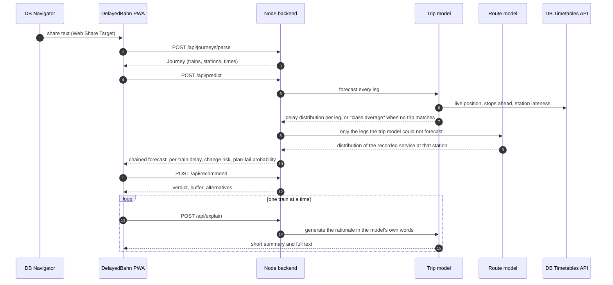

1. **Parse.** A grammar reads the DB share text in German or English into trains, stations and times, and resolves stations to EVA numbers.
2. **Forecast.** The trip model receives every leg. For a train it finds in the live timetable it reads the delay so far, the stops ahead, how earlier trains on the line did today and how late the station is running, and answers with a probability for each minute of delay plus the chance of cancellation.
3. **Complement.** For legs with no recorded or live trip, the backend sends exactly those legs to the route model, which forecasts the recorded service at that station from its history. The reply names both models and marks which legs came from which.
4. **Chain.** The change probability at each transfer comes from both trains' distributions and the planned transfer time. The plan-fail probability chains all changes. This is a JavaScript port of the Python `connection.py`, so the buffer slider re-runs it on the client without a round trip.
5. **Advise.** The recommendation feature turns the chain into a verdict, a leave-home-by time and scored alternatives.
6. **Explain.** After the forecast, the app asks for each train's explanation in turn. The card shows the inputs first and swaps in the model's own words when they arrive.

## Architecture

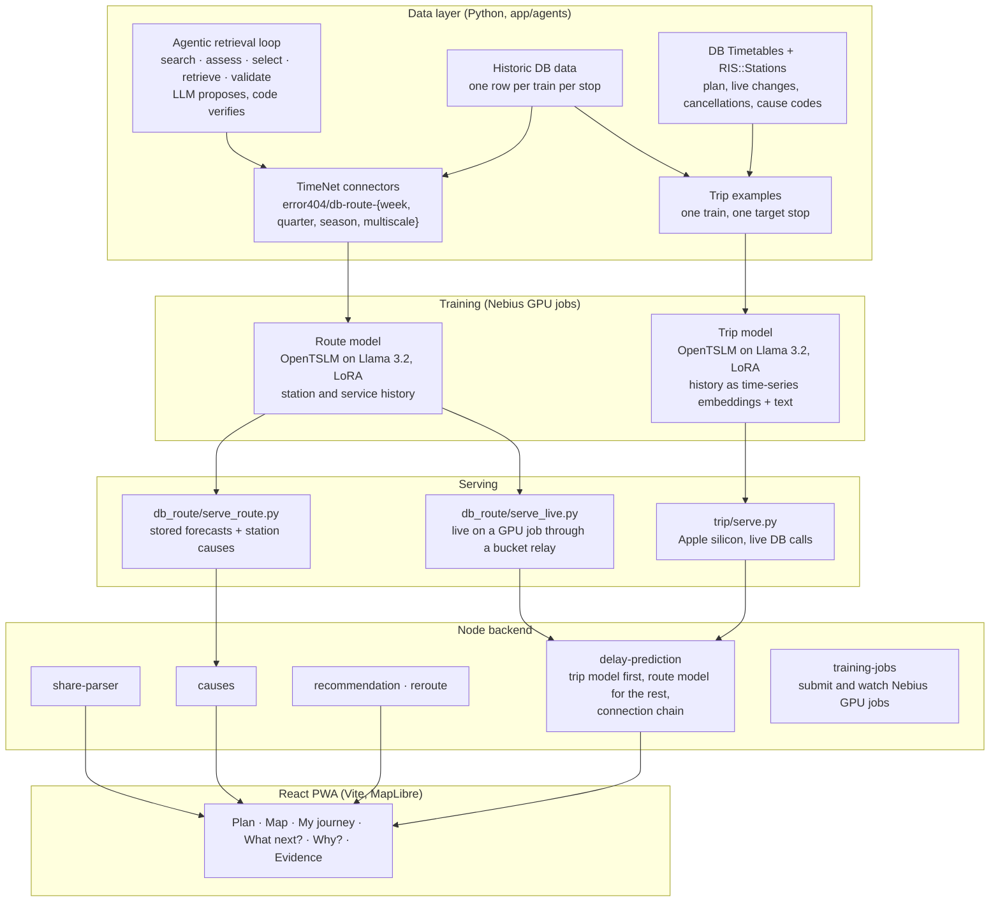

**Three layers, one feature name per layer.** Every feature lives at `app/<layer>/src/features/<name>/` on the frontend, the backend and the agents side, so `delay-prediction` in the app, in the backend and in the Python model server is one feature in three halves.

**Serving on one laptop.** The trip model runs on the Mac's GPU through MPS. The route model's stored forecasts and station causes are served from parquet and npz files with no torch at all. When a GPU job is up on Nebius, the route model also answers live per request: Nebius jobs have no inbound network, so requests travel as files through the project's storage bucket and the job answers the same way.

**The backend has no npm dependencies.** Node's built-in `http`, `fetch` and `crypto` cover parsing, chaining, both model calls and the GPU job client.

## Data

### Sources

All product data comes from Deutsche Bahn's official API Marketplace and from open datasets built from the same feeds.

| Source | What we use it for |
|---|---|
| [Timetables API](https://developers.deutschebahn.com/db-api-marketplace/apis/product/timetables) | Planned stops (`plan`), live delays, cancellations and platform changes (`fchg`), the route of every train |
| [RIS::Stations](https://developers.deutschebahn.com/db-api-marketplace/apis/product/ris-stations) | Official station names and EVA numbers |
| [`piebro/deutsche-bahn-data`](https://huggingface.co/datasets/piebro/deutsche-bahn-data), CC BY 4.0 | Stored Timetables responses, one row per train per stop. The models are trained on this. |
| DB cause codes (IRIS) | Cause families per station for the "Why" tab and the cause-share series |

- **Historic DB data** trains the models: `scripts/db_live_extract.py` merges plan and changes into one row per train per stop, `trip/build.py` turns rows into examples.
- **Live DB data** is fetched when a traveller shares a trip (`trip/live.py`) and assembled into the same row format the model was trained on.

### What the DB data solves

| Traveller question | DB data that answers it |
|---|---|
| "Which train and station is this?" | Timetables `station` lookup and RIS::Stations turn the share text into exact station IDs |
| "Is my train late right now?" | The change feed gives the current delay at every stop the train has passed |
| "Will it get worse before my stop?" | Planned route and stops ahead, plus how earlier trains on the same line did today |
| "Is this station having a bad day?" | Late share across all trains at the station recently |
| "Will this train be cancelled?" | Cancellation flags in the change feed, and how often this route was cancelled before |
| "Will I make my change?" | Planned arrival and departure of both trains, combined with both delay distributions |

## Agentic data retrieval

Before training, an agent decided which open time-series sources to use and how to map their columns onto our spec. It is a search, assess, select, retrieve and validate loop in which **the LLM proposes and deterministic code disposes**: nothing the agent says is used until code has verified it.

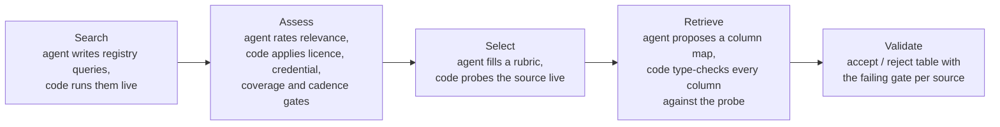

| Step | The agent proposes | The code verifies or refuses |
|---|---|---|
| Search | registry queries, from the data spec | every query runs against the live registry API |
| Assess | relevance of each candidate, with a reason | licence allow-list, credentials, coverage window, cadence, cheapest first |
| Select | rubric fields per surviving source | a live probe measures rows, columns and coverage |
| Retrieve | a column map from the source schema to the spec | every named column must exist and type-check against the probe, or the map is rejected |
| Validate | | `REJECTIONS.md` with the failing gate per source |

An unverifiable proposal is dropped, never negotiated. Every LLM call, its prompt and its answer are logged so a reader can audit each decision. The loop also runs without an LLM: the same gates and probes, no proposals.

**Why it matters for the model.** What gets dropped is noise. Sources with the wrong cadence, an incompatible licence or a schema that does not type-check never reach the training set, so the model's inputs are only the columns the spec asked for and the probe confirmed.

## Models

Both models share one recipe: **Llama 3.2**, an open-source language model, extended with **OpenTSLM** so it can read time series next to text, started from a published OpenTSLM checkpoint and fine-tuned with LoRA on Nebius GPUs. Both answer with `Answer: <minutes>` or `Answer: cancelled`. Instead of reading one number, we read the model's probability for each minute of delay, which gives a likely delay, a range and the chance of cancellation.

### Trip model: one train, one target stop, today

- **Example:** a train heading to a stop. Inputs: the delays so far on this trip, this train number's usual gains along the line, the corridor's recent delays, how late the station is running, and the forecast of a statistical model on the same features.
- **Live at request time.** The server fetches the train's current position from the Timetables API, assembles the row the model was trained on, and forecasts. When live data is unavailable it answers with an estimate from recorded trips and says so.
- **Explains itself.** The same model writes its rationale freely, so the app shows the model's own words next to the forecast.

### Route model: any recorded service, any station, any date

- **Example:** a service group at a station on a travel date, with its delay, throughput and cause-share history at that stop and across the service. Several history profiles were trained and compared; the **quarter** profile is used in the app.
- **Covers what the trip model cannot,** including trips days ahead for which the live timetable has nothing yet. It also carries the cause families per station behind the "Why" tab.
- **Served two ways:** from stored forecasts on the laptop, or live per request on a GPU job through the bucket relay.

### Why two models

They are strong in different places. The trip model is strongest for a train that is running now, because it reads its live position. The route model knows the recorded services on the corridor regardless of the day. The backend asks the trip model first and hands only the legs it could not forecast to the route model.

## Approach: two methods, combined

The model can take the same delay history in two ways (`--prompt-mode` in `trip/train.py`):

- **Time-series embeddings:** the delay series go through OpenTSLM's time-series encoder, which turns them into embeddings the language model reads directly.
- **Pure text:** the same numbers are written into the prompt as text, together with a short sentence that describes them.
- **Combined (split):** the long history, the same-train gains and the corridor series as embeddings; the short recent trajectory as text.

Each method is an existing tool on its own. We train each separately and then the combination, so the comparison shows what each part adds: text only, embeddings only, and embeddings plus text.

## Evaluation

- **Baselines.** Every model is compared against simple and statistical baselines on the same information: persistence, route history, gradient boosting, XGBoost with the same features.
- **Split by time.** The test period is later than training, so no future information leaks. The trip model is also scored on a later period it never saw in any form.
- **Metrics.** Median error of the predicted delay in minutes, CRPS for the whole distribution, and the share of trains forecast to within a minute.

## Code structure

```
app/backend/           Node API, zero dependencies
  src/features/share-parser/        DB share text → Journey (grammar, station lookup)
  src/features/delay-prediction/    trip model → route model complement → connection chain
  src/features/recommendation/      verdict, buffer, leave-home-by, reroute
  src/features/causes/              cause families per station
  src/features/journey-search/      direct train lookups on the DB API
  src/features/training-jobs/       Nebius Serverless AI jobs: submit, status, logs, cancel
app/frontend/          React 19 + Vite PWA, MapLibre map, one folder per screen under src/features/
app/agents/            Python
  src/features/db_delay/trip/       trip model: build examples, train, serve, run_local.sh, connection.py
  src/features/db_route/            route model: connectors, train_route.py, serve_route.py, serve_live.py,
                                    relay_proxy.py, TRAINING.md
  src/features/db_route/discover/   the agentic data retrieval loop
  connectors/error404/              TimeNet connectors for the db-route profiles
scripts/               DB Timetables and RIS::Stations clients
team-setup/            coordination: contract, owners, decisions
```

| File | What it does |
|---|---|
| `scripts/db_live_extract.py` | Calls Timetables and RIS::Stations, merges plan and changes into one row per train per stop |
| `app/agents/src/features/db_route/discover/run.py` | Runs the retrieval loop: search, assess, probe, verify |
| `app/backend/src/features/share-parser/grammar.js` | Reads DB share text into a journey |
| `app/backend/src/features/delay-prediction/routes/delay-prediction.js` | Asks the trip model, complements with the route model, chains changes |
| `app/backend/src/features/delay-prediction/connection.js` | Change and journey probabilities, a port of `connection.py` |
| `app/backend/src/features/recommendation/routes/recommendation.js` | Verdict, alternatives, reroute |
| `app/agents/src/features/db_delay/trip/build.py` | Stop records → training examples |
| `app/agents/src/features/db_delay/trip/train.py` | Fine-tunes the trip model |
| `app/agents/src/features/db_delay/trip/serve.py` | Serves the trip model with live Timetables data and explanations |
| `app/agents/src/features/db_route/train_route.py` | Fine-tunes the route model per history profile |
| `app/agents/src/features/db_route/serve_route.py` | Serves stored route forecasts and station causes |
| `app/agents/src/features/db_route/serve_live.py` | Serves the route model live on a GPU job through the bucket relay |

## Quickstart

```bash
git clone https://github.com/KiraKami-dev/temporal_ai_error404.ai.git
cd temporal_ai_error404.ai
cp .env.example .env               # add DB_CLIENT_ID and DB_API_KEY from developers.deutschebahn.com
ln -s ../../.env app/backend/.env

python3 scripts/db_timetables.py "Hamburg Hbf"                      # live departures from DB
```

**App without model files**

```bash
cd app/backend && npm run dev                                       # API on http://localhost:8000
npm --prefix app/frontend ci && npm --prefix app/frontend run dev   # app on http://127.0.0.1:5173
```

**App with the trained models** (Apple silicon; model files from the team's `delayedBahn-model.zip`, see `app/agents/src/features/db_delay/trip/README.md`)

```bash
D=app/agents/src/features/db_delay/trip
$D/run_local.sh setup ~/delayedBahn-env ~/delayedBahn-model/checkpoint.pt ~/delayedBahn-model/september_v7_test.parquet
cp -R ~/delayedBahn-model/xgb ~/delayedBahn-env/xgb
bash app/agents/src/features/db_route/fetch_serving_data.sh && app/agents/src/features/db_route/serve_route.sh --port 8501   # route model and causes
ENV_FILE=.env $D/run_local.sh start ~/delayedBahn-env               # trip model and app on http://localhost:8000
```

The start script detects the route server and wires it in as the complement and as the causes source. To run the route model live on a GPU job instead, see "Live serving" in `app/agents/src/features/db_route/TRAINING.md`.

**On a phone:** `adb reverse tcp:8000 tcp:8000`, open `http://localhost:8000`, install, then share from DB Navigator.

## Team

**error404.ai** — Akshat Khair (app, backend, serving), Gaurav Kulkarni (agentic data retrieval, route datasets), Jonas Stenglein (trip model), Yash (data extraction)

## Built with

- European Hackathon League Zurich
- Deutsche Bahn API Marketplace: [Timetables](https://developers.deutschebahn.com/db-api-marketplace/apis/product/timetables), [RIS::Stations](https://developers.deutschebahn.com/db-api-marketplace/apis/product/ris-stations)
- [OpenTSLM](https://arxiv.org/abs/2510.02410), Llama 3.2, LoRA, XGBoost, TimeNet, DuckDB
- Nebius GPUs, Node 22, React 19, Vite, MapLibre

## Screenshots

A trip from DB Navigator through DelayedBahn, on a phone.

<table>
  <tr>
    <td align="center" width="33%"><br><b>1. Start</b><br>Paste the journey shared from DB Navigator, or try the example trip.</td>
    <td align="center" width="33%">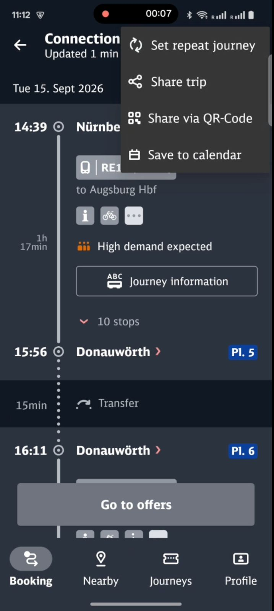<br><b>2. Share from DB Navigator</b><br>Open the connection and choose "Share trip".</td>
    <td align="center" width="33%">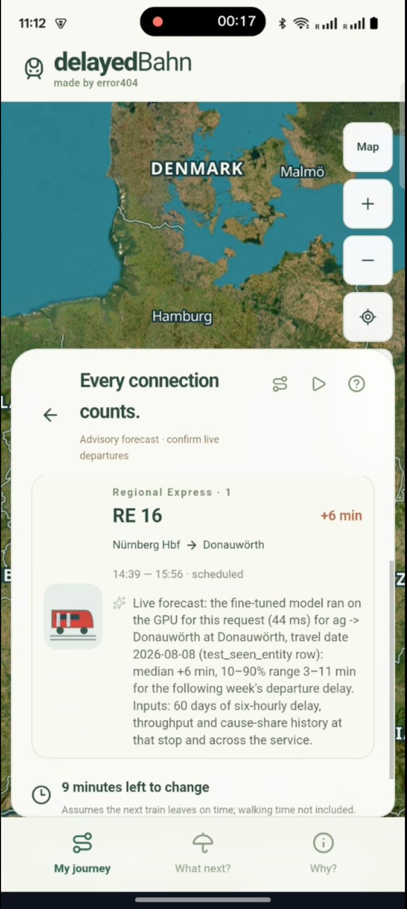<br><b>3. My journey</b><br>One card per train with the forecast delay and the time left to change.</td>
  </tr>
  <tr>
    <td align="center">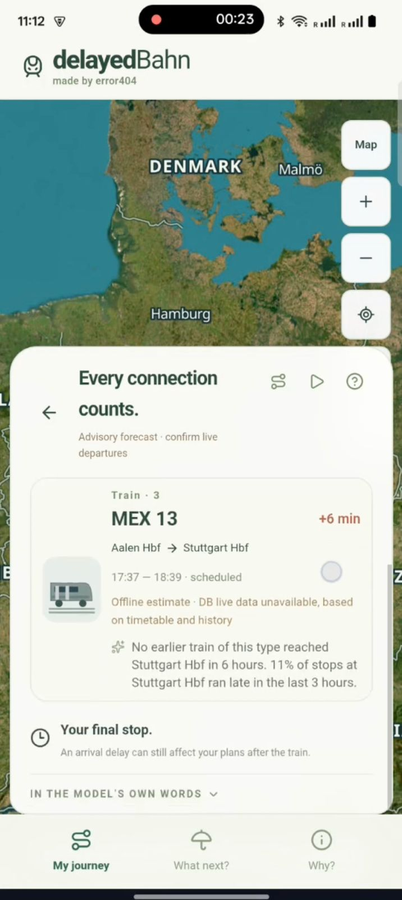<br><b>4. Every train</b><br>Each card says where its forecast comes from and what the model read.</td>
    <td align="center">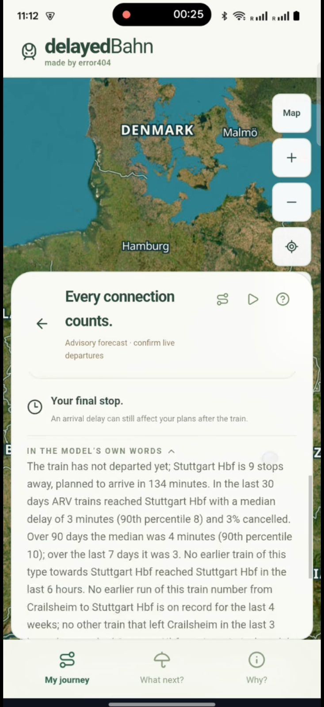<br><b>5. In the model's own words</b><br>The explanation the model writes itself for this train.</td>
    <td align="center">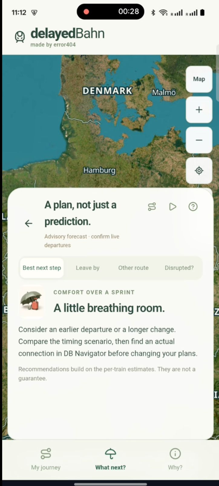<br><b>6. What next?</b><br>The best next step for the whole trip.</td>
  </tr>
  <tr>
    <td align="center">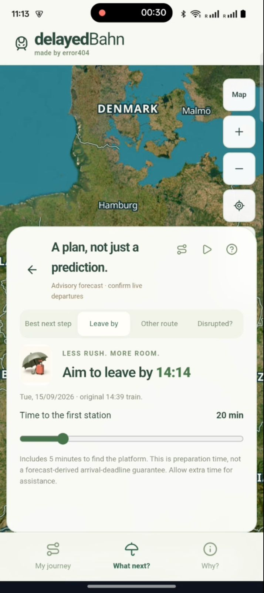<br><b>7. Leave by</b><br>When to leave home to reach the first train.</td>
    <td align="center">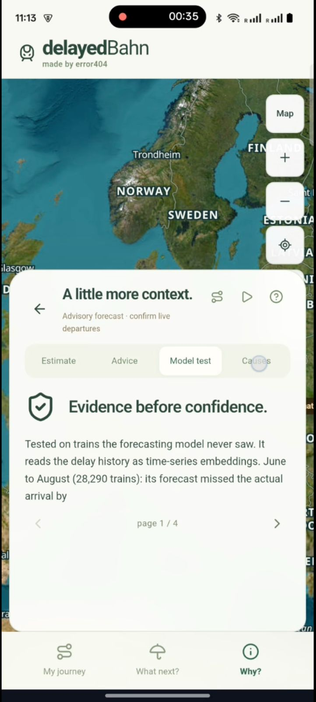<br><b>8. Why? Model test</b><br>How the model was tested on trains it never saw.</td>
    <td align="center">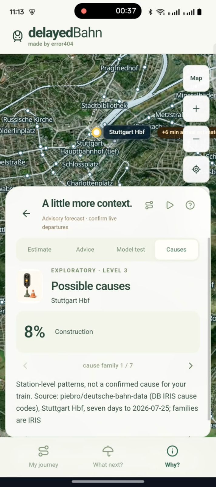<br><b>9. Why? Causes</b><br>What usually goes wrong at the station, from DB cause codes.</td>
  </tr>
</table>
